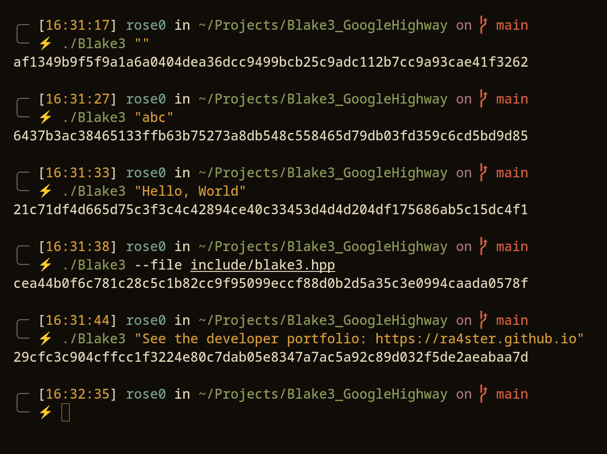

# Universal Blake3

<div align="center">
    
    <hr />
</div>

This is a **header-only** implementation of [BLAKE3](<https://en.wikipedia.org/wiki/BLAKE_(hash_function)#BLAKE3>) with cross-platform, cross-CPU architecture compatibility. Whereas many implementations are well-optimized for certain flags (AVX-256, FMA, etc.) this implementation is optimized using [Google Highway](https://github.com/google/highway), an SIMD runtime which can dispatch to quite a lot of specialized CPU flags such as RISC-V (RVV), Diamond Rapids (AVX10_2), WebAssembly (WASM, WASM_EMU256) and more.

## Performance Results

I'll let these results speak for themselves.

|            | Universal Blake3        | Reference `blake3` 1.0.11 |
| ---------- | ----------------------- | ------------------------- |
| 1 thread   | 61–65 ms (4.1–4.4 GB/s) | 60–63 ms (4.3–4.5 GB/s)   |
| 20 threads | 9.0–9.5 ms (28–30 GB/s) | 8.1 ms (33 GB/s)          |

Single-threaded, this implementation matches the official BLAKE3 library, which uses hand-written AVX2 assembly on this CPU. Multithreaded, it comes within about 10 to 15%.

### Thread scaling

| Threads | Time    | Throughput |
| ------- | ------- | ---------- |
| 1       | 63.3 ms | 4.2 GB/s   |
| 2       | 34.5 ms | 7.8 GB/s   |
| 4       | 19.5 ms | 13.8 GB/s  |
| 6       | 13.9 ms | 19.4 GB/s  |
| 8       | 12.4 ms | 21.7 GB/s  |
| 12      | 10.2 ms | 26.3 GB/s  |
| 20      | 9.3 ms  | 28.8 GB/s  |

Scaling is close to linear across the first 6 performance cores.

### Test setup

- **CPU:** Intel Core i7-12700H (6 P-cores + 8 E-cores, 20 threads), AVX2
- **Compiler:** `icpx -O3 -march=native -std=c++20`
- **Single-threaded:** `Blake3::Update`
- **Multithreaded:** `Blake3::UpdateParallel`, which splits the input into 256 KiB subtrees hashed on a persistent thread pool
- **Reference:** the official BLAKE3 Rust implementation via the Python `blake3` package, timed on a buffer of the same size.

Run `make bench` to reproduce the benchmark on your own machine.

## Building

The library is extremely simple. The only dependency is Google Highway, so make sure to pull with submodules. After, the only thing left to do is run make!

```bash
git clone --recurse-submodules https://github.com/Ra4ster/Universal-Blake3

cd Universal-Blake3

make
```

> **Note:** Consider looking at the flags inside of the `Makefile` before you run `make`. Some flags/commands may not be right for you! In particular, the default compiler is `icpx`, which I'm guessing you are not using. Also, you may benefit from manually turning on flags like -mfma, -mavx2, etc.

### Showcase

You can also test out the program and use it easily by running `./Blake3 "content to hash"`.

Here are some useful hashes to test out:

- "": af1349b9f5f9a1a6a0404dea36dcc9499bcb25c9adc112b7cc9a93cae41f3262
- "abc": 6437b3ac38465133ffb63b75273a8db548c558465d79db03fd359c6cd5bd9d85
- "Hello, World": 21c71df4d665d75c3f3c4c42894ce40c33453d4d4d204df175686ab5c15dc4f1

<div align="center">
    
</div>

---

If you are interested in knowing more about the developer, visit [Ra4ster](https://ra4ster.github.io).

_Thank you for the support!_ ❤️
